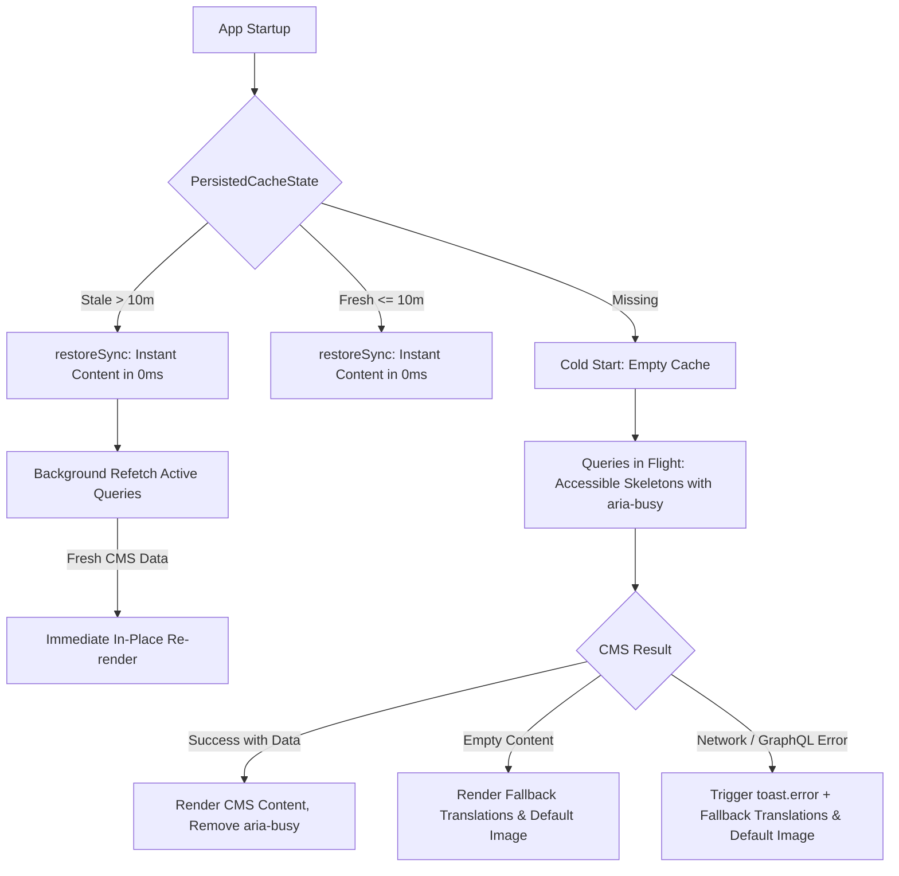

# Headless CMS Caching & Loading Architecture

This document describes the caching, revalidation, and accessible loading state architecture for Headless CMS (WordPress) content in `kukkuu-ui`.

---

## 1. Problem Statement

Headless CMS queries (such as header menus, footer links, hero sections, and arbitrary CMS pages) can experience network latency or slow response times from the WordPress backend.

Without structured caching and loading states:

- Returning users would experience layout shifts (Cumulative Layout Shift, CLS).
- Heading and hero texts would abruptly swap from translation fallbacks to CMS content during reading.
- Screen readers could encounter unannounced content mutations, violating WCAG 2.2 accessibility guidelines.

Our architecture ensures **zero layout shifts, 0ms initial paints for repeat visits, motion-safe accessible skeleton states, and silent background cache revalidation**.

---

## 2. Architecture Overview



---

## 3. Persistent Cache & Stale-While-Revalidate (SWR)

### Synchronous Cache Restoration (`restoreSync`)

Apollo Client's `InMemoryCache` is persisted to `localStorage` using `TimedApolloCachePersistor` (`src/domain/headlessCms/persistor.ts`).

When the application boots:

- `restoreSync()` reads and populates Apollo's cache **synchronously** before React mounts.
- Returning visitors see complete, cached content on the very first paint (0ms), completely eliminating flashes and layout shifts.

### Cache States (`PersistedCacheState`)

Cache freshness is evaluated via `getPersistedCacheState()`:

1. **`PersistedCacheState.Missing`**: No cache or timestamp exists. The client performs a cold start.
2. **`PersistedCacheState.Fresh`**: Cache age is within TTL (default: 10 minutes). Restored synchronously; no immediate refetch needed.
3. **`PersistedCacheState.Stale`**: Cache age exceeds TTL. Restored synchronously in 0ms (no artificial purge, zero blinking), and scheduled for silent background revalidation.

### Background Revalidation (`useCmsCacheRevalidation`)

When a client is marked as `Stale`, `useCmsCacheRevalidation` (hooked in `PageLayout.tsx`) calls `revalidateStaleCmsCache(client)`.

- Active queries are refetched over the network in the background.
- When updated content arrives, Apollo updates its cache and React components update in place without re-triggering skeleton states.

---

## 4. Cold Loads & Accessible Skeleton States

### Distinguishing Initial Loads from SWR (`useCmsLoadingState`)

When Apollo refetches queries in the background, `loading` is set to `true` even though `data` is already present.

`useCmsLoadingState` (`src/hooks/useCmsLoadingState.ts`) evaluates:

```ts
isInitialLoading = loading && !data;
```

This ensures skeleton placeholders are displayed **only** on initial cold visits when no data is available in the cache, and never flash back during SWR refetches.

### Declarative Wrapper Pattern (`SkeletonLoader`)

To avoid repetitive ternary conditions and manual `aria-busy` toggling across components, use the declarative `<SkeletonLoader>` wrapper component:

```tsx
import {
  SkeletonLoader,
  SkeletonText,
} from '../../../common/components/skeleton/CmsSkeleton';

<SkeletonLoader
  isLoading={isLoading}
  skeleton={<SkeletonText titleWidth="50%" lineWidths={['75%']} />}
>
  <h1>{title}</h1>
  {description && <p>{description}</p>}
</SkeletonLoader>;
```

- **Automatic `aria-busy`**: Sets `aria-busy="true"` on the wrapper container (`<div aria-busy="true">`) while `isLoading` is true, and removes it once data arrives.
- **Custom Container or Fragment**: Use `as="section"` for custom tags, or `as={null}` to omit the wrapper element when wrapping layouts (e.g. `HDSFooter.Base` or grid layouts).
- **Lazy Evaluation**: Pass a render function `children={() => <Component />}` to defer executing child logic until `isLoading` is false, preventing undefined errors on unloaded data:
  ```tsx
  <SkeletonLoader isLoading={isLoading} skeleton={<PageSkeleton />} as={null}>
    {() => <Page content={data.content} />}
  </SkeletonLoader>
  ```

### Skeleton Components (`src/common/components/skeleton/CmsSkeleton.tsx`)

- **`SkeletonLoader`**: Declarative wrapper managing `aria-busy` and conditional skeleton-to-children swaps.
- **`SkeletonText`**: Standardized typography composite rendering a heading line (`var(--fontsize-heading-xl)`) and description lines with HDS-aligned margins (`var(--spacing-m)`).
- **`SkeletonLine`**: Renders typography height reservations for individual lines (`aria-hidden="true"`).
- **`HeroImageSkeleton`**: Summer-colored (`var(--color-summer)`) brand-aligned shimmer reservation. Heavy fallback images are not preloaded behind the skeleton.
- **`NavPillSkeleton`**: Menu item placeholder reserving navigation bar height to prevent header layout shift.
- **`FooterPillSkeleton`**: Footer link placeholder with high-contrast shimmer against the dark footer background.

### WCAG 2.2 Accessibility Compliance

- **Containers**: Wrapped with `aria-busy="true"` while content is loading, removed once content arrives.
- **Skeletons**: Marked with `aria-hidden="true"` so assistive technologies ignore shimmer shapes.
- **Semantic Headings**: Semantic `<h1>` elements are omitted until real text is loaded to avoid false navigation cues.
- **Motion Safety**: Handled via CSS `@media (prefers-reduced-motion: reduce)`, replacing continuous shimmer animations with static subtle opacity.

---

## 5. Fail-Safe Fallbacks & Error Reporting

If a CMS query fails due to a network or GraphQL error:

1. Apollo's `errorLink` in `src/domain/headlessCms/client.ts` raises a deduplicated toast error:
   ```ts
   toast.error(t('cms.error.failedToLoadContent'), { toastId: 'cms-error' });
   ```
2. The UI cleanly and silently falls back to static translation keys (e.g. `t('appName')`) and default assets (`/images/Culture_kids@2x.jpg`).
3. If CMS query succeeds but returns empty or null content, static translation defaults are used without an error toast.

---

## 6. GDPR & Cookie Consent Registration

Because persistent caching utilizes `localStorage`, the storage key is registered in the City of Helsinki Cookie Consent manager (`src/domain/cookieConsent/CookieConsent.tsx`):

- **Key**: `${AppConfig.cmsApolloCacheLocalStorageKey}*` (`kukkuu-ui-cms-{env}-apollo-cache*`)
- **Category**: `essential-custom` (strictly necessary technical storage for site layout, navigation, and CMS content)
- **Duration**: 1 year
- **Localization**: Localized explanations registered in `fi.json`, `sv.json`, and `en.json` under `consent.cookies.apolloCache`.

---

## 7. Configuration Reference

| Environment Variable                          | Config Property                              | Default           | Description                                                                   |
| :-------------------------------------------- | :------------------------------------------- | :---------------- | :---------------------------------------------------------------------------- |
| `VITE_CMS_URI`                                | `AppConfig.cmsUri`                           | Test CMS endpoint | Headless CMS GraphQL API endpoint.                                            |
| `VITE_APOLLO_PERSISTED_CACHE_TIME_TO_LIVE_MS` | `AppConfig.apolloPersistedCacheTimeToLiveMs` | `600000` (10 min) | Duration before cached CMS content is marked `Stale` and revalidated via SWR. |
