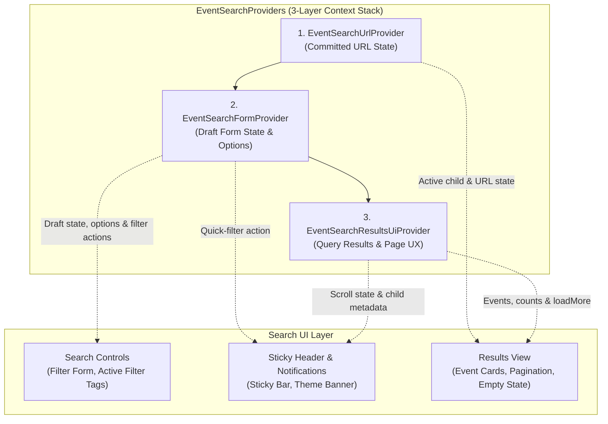
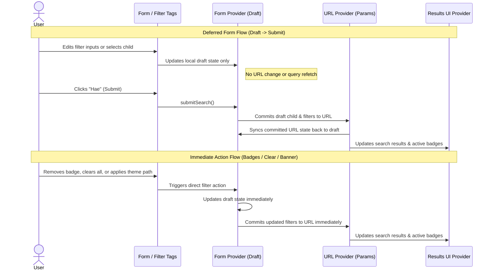

# Event Search Architecture

This directory implements the guardian-facing event search experience using a
**two-tier state model** and a **3-layer React Context/Provider stack**.

<!-- START doctoc generated TOC please keep comment here to allow auto update -->
<!-- DON'T EDIT THIS SECTION, INSTEAD RE-RUN doctoc TO UPDATE -->

- [Two-Tier State Model](#two-tier-state-model)
- [Provider Stack & Data Flow](#provider-stack--data-flow)
- [Deferred vs. Immediate Action Flows](#deferred-vs-immediate-action-flows)
- [Contexts & Providers](#contexts--providers)
- [Module Organization](#module-organization)

<!-- END doctoc generated TOC please keep comment here to allow auto update -->

## Two-Tier State Model

To avoid firing network requests or mutating browser history on every checkbox
toggle, dropdown selection, or date input change, event search separates state
into two tiers:

- **Committed State (URL-backed)**:
  - Managed by `EventSearchUrlProvider` (`EventSearchUrlContext`).
  - The URL query string is the single source of truth for active search
    results and filter badges.
- **Draft State (Form-local)**:
  - Managed by `EventSearchFormProvider` (`EventSearchFormContext`).
  - Holds uncommitted form selections (`draftChildId`, `draftFilters`) while
    the user interacts with form controls, and automatically re-syncs when the
    URL changes externally (e.g., browser back/forward navigation).
  - Commits to the URL either **deferred** on form submit or **immediately**
    for direct actions (removing a filter badge, clearing all filters, or
    applying a recommended theme path).

---

## Provider Stack & Data Flow

`EventSearchProviders` stacks three specialized context providers so each
concern is isolated:

---

## Deferred vs. Immediate Action Flows

---

## Contexts & Providers

- **`EventSearchProviders`**: Composite wrapper nesting the URL, Form, and
  Results UI providers in order.
- **`EventSearchUrlContext` / `EventSearchUrlProvider`**: Parses committed
  filters and the active child ID from the URL, sanitizes invalid/foreign child
  IDs, and exposes `commitSearchToUrl`.
- **`EventSearchFormContext` / `EventSearchFormProvider`**: Coordinates two-way
  draft/URL synchronization, dropdown options, form submission, and removable
  filter badges with focus management.
- **`EventSearchResultsUiContext` / `EventSearchResultsUiProvider`**: Executes
  and paginates the event search query, resolves active child metadata and
  notifications, tracks sticky scroll state, and provides screen-reader
  announcements.

---

## Module Organization

Rather than placing business logic inside providers or UI components,
responsibilities are split by layer:

- **Custom Hooks**: Each provider delegates its logic to focused hooks covering
  three areas:
  - _URL & Draft Synchronization_: Parsing/serializing URL query parameters,
    cleaning up invalid child IDs, and keeping local form draft state
    synchronized with committed URL state.
  - _Filter Options & Active Badges_: Supplying localized select options
    (children, theme paths, accessibility, languages) and deriving removable
    filter badges with keyboard focus continuity.
  - _Event Querying & Results UX_: Fetching available events via Apollo,
    filtering and paginating results client-side, tracking scroll position for
    the sticky header, and managing dismissible recommendations.
- **UI Components**: Thin presentation components that subscribe only to the
  context slices they need—split into the page container (handling
  profile/child redirects), search controls (filter form and active filter
  tags), sticky/notification banners, and result cards.
- **Pure Utilities**: Stateless helper functions for URL parameter
  parsing/serialization, date formatting, event/occurrence eligibility
  matching, and client-side pagination.
