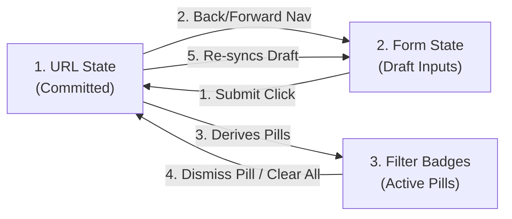
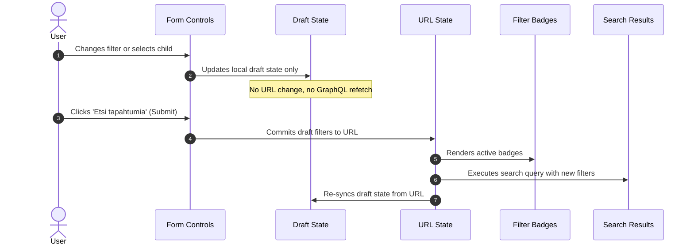
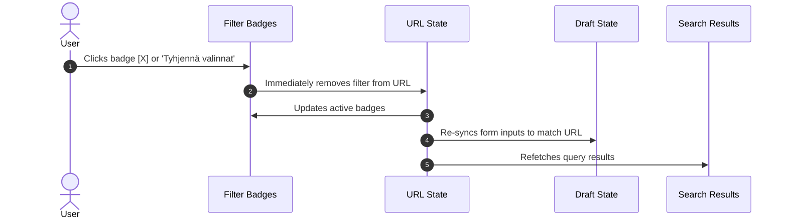

# Event Search Architecture

This directory implements the guardian-facing event search experience using a
**three-state synchronization model** and a **3-layer React Context stack**.

<!-- START doctoc generated TOC please keep comment here to allow auto update -->
<!-- DON'T EDIT THIS SECTION, INSTEAD RE-RUN doctoc TO UPDATE -->

- [The Triad of Search State](#the-triad-of-search-state)
- [Action Flows & State Transitions](#action-flows--state-transitions)
  - [Flow A: Deferred Form Submit](#flow-a-deferred-form-submit)
  - [Flow B: Immediate Action](#flow-b-immediate-action)
- [Key Invariants (Golden Rules)](#key-invariants-golden-rules)
- [How to Add a New Search Filter](#how-to-add-a-new-search-filter)
  - [1. Declare the Filter Type](#1-declare-the-filter-type)
  - [2. Follow TypeScript Compiler Errors](#2-follow-typescript-compiler-errors)
  - [3. Create the Form Field Component](#3-create-the-form-field-component)
  - [4. Pass the Filter to the GraphQL Search Query](#4-pass-the-filter-to-the-graphql-search-query)
- [Contexts & State Hooks](#contexts--state-hooks)
- [Directory Organization](#directory-organization)

<!-- END doctoc generated TOC please keep comment here to allow auto update -->

---

## The Triad of Search State

To prevent state inconsistencies and unnecessary network traffic, event search
is organized into three synchronized state slices:



| State Slice                  | Location / Storage                                | Purpose & Lifecycle                                                                                                                                                                                                                                               |
| :--------------------------- | :------------------------------------------------ | :---------------------------------------------------------------------------------------------------------------------------------------------------------------------------------------------------------------------------------------------------------------- |
| **1. URL State (Committed)** | Browser URL query string                          | **Single source of truth** for active search query results, shareable links, and active badges. Managed by `EventSearchUrlProvider` (`useEventSearchUrlContext`). Survives page refreshes and browser history navigation.                                         |
| **2. Form State (Draft)**    | Form-local state (`draftFilters`, `draftChildId`) | **Staged user input**. Allows guardians to change multiple criteria freely without triggering unwanted GraphQL queries or polluting browser history. Commits to URL only when the user clicks "Etsi tapahtumia" (Submit). Access via `useEventSearchFormContext`. |
| **3. Filter Badges**         | Active badges under submit button                 | **Visual representation of committed filters**. Rendered via `EventSearchFilterBadges`. Clicking `×` on a badge or clicking "Tyhjennä valinnat" immediately updates the URL and re-syncs the form inputs. Access via `useEventSearchFormContext`.                 |

---

## Action Flows & State Transitions

### Flow A: Deferred Form Submit

Triggered when the user interacts with form controls (selects, date pickers, checkboxes) and submits the form:



### Flow B: Immediate Action

Triggered when the user dismisses an active badge (`×`), clears all filters, or applies a recommended theme path banner:



---

## Key Invariants (Golden Rules)

1. **Never query GraphQL on form input changes**: GraphQL queries only execute in response to URL state changes, never during form typing or checkbox toggling.
2. **Never write to the URL directly from form inputs**: Form controls only update form draft state (`draftFilters`). They flush to the URL only on form submission.
3. **Badges reflect committed URL state**: The badges list is derived from `committedFilters`, not `draftFilters`. However, dismissing a badge updates the URL immediately.
4. **URL query parameters are canonical**: External URL navigation (browser back/forward, bookmarks, external links) automatically resets the form draft state to match the URL.

---

## How to Add a New Search Filter

Follow this 4-step checklist when adding a new search filter category (e.g. `venue`):

### 1. Declare the Filter Type

In `types/filterTypes.ts`, add the property and its type to `EventSearchFilters`:

```ts
export type EventSearchFilters = {
  themePaths: string[];
  // ... existing fields
  venue: string[]; // <-- new field
};
```

### 2. Follow TypeScript Compiler Errors

TypeScript will automatically flag missing definitions across the codebase:

- **`searchFilterUrlConfig.ts`**: Add entry to `FILTER_URL_CONFIG` defining `paramName`, `defaultValue`, `isActive`, `parseFromUrl`, and `writeToUrl`. (This also updates `SEARCH_URL_PARAMS`, `DEFAULT_SEARCH_FILTERS`, and `parseSearchFiltersFromUrl` automatically).
  - _Optional (`FilterOptionsContext`)_: If the filter represents dynamic options (like `themePaths` or `languages`) and URL parameter values should be validated/whitelisted against known options during URL parsing, also add the option list to `FilterOptionsContext`. For booleans, dates, or freeform filters, `FilterOptionsContext` does not need updating.
- **`hooks/useActiveBadges.ts`**: Add entry to `BADGE_GENERATORS` defining how the badge label renders.
- **`hooks/useFilterBadges.ts`**: Add entry to `BADGE_FILTER_REMOVERS` defining how clicking `×` removes the filter.

### 3. Create the Form Field Component

1. Create `fields/VenueFilterField.tsx` consuming `useEventSearchFormContext()` (`draftFilters.venue` and `updateDraftFilter('venue', ...)`).
2. Export it from `fields/index.ts` and mount it inside the accordion grid in `EventSearchFilterForm.tsx`.

### 4. Pass the Filter to the GraphQL Search Query

Update `eventsSearchQuery.ts`, `EventsSearchTypes.ts`, `useEventsSearch.ts`, and `cacheConfig.ts` (`relayStylePagination` keyArgs) to pass the new filter argument to `Query.events` on the backend API.

---

## Contexts & State Hooks

The feature uses three context providers stacked in `EventSearchProviders`:

- **`EventSearchUrlProvider`**: Manages URL parsing and browser history navigation. Access via `useEventSearchUrlContext()`.
- **`EventSearchFormProvider`**: Manages form draft state, option lists, and active badges. Access via `useEventSearchFormContext()`.
- **`EventSearchResultsUiProvider`**: Manages Apollo query results, Relay cursor pagination (`fetchMore`), sticky header scroll state, and screen-reader announcements. Access via `useEventSearchResultsUiContext()`.

---

## Directory Organization

```text
src/domain/event/search/
├── ChildEventsSearch.tsx         # Page container & routing guard
├── EventSearchFilterForm.tsx     # Form orchestrator (accordion, submit button)
├── EventSearchFilterBadges.tsx   # Active filter pills & clear-all button
├── searchFilterUrlConfig.ts      # URL parameter definitions & mapping strategies
├── searchDateUtils.ts            # Finnish & ISO date parser/formatter helpers
├── eventSearchUtils.ts           # URL filter helpers and event card formatting utilities
├── context/                      # React Context providers (URL, Form, Results)
├── fields/                       # Form input field components (e.g. ThemePath, Language)
├── hooks/                        # Custom hooks (state sync, options, sticky header)
└── types/                        # Filter types and contracts
```
